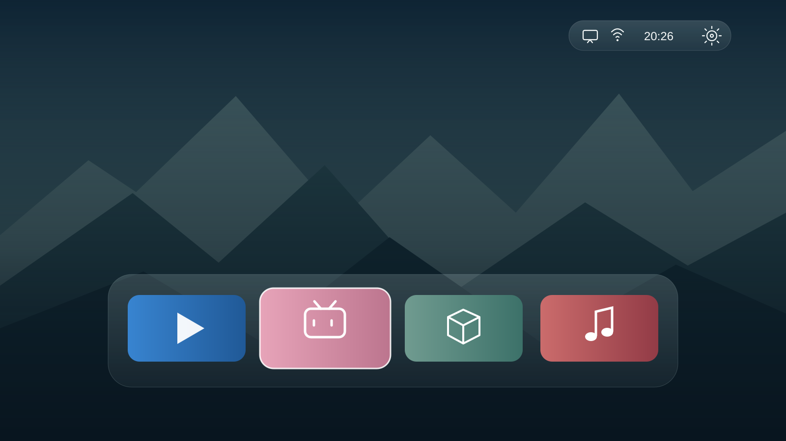

# Banana TV

给安卓电视一个更安静的首页：中文设置、可调 Dock、动态壁纸、天气和配套屏保。

[构建当前源码](#构建与来源) · [历史版 0.1.11](https://github.com/sogud/banana-tv/releases/tag/v0.1.11) · [English](README.md) · [安装与恢复](docs/install.md)



*布局示意图，非真实电视截图；应用列表取决于电视上已经安装的软件。*

## 源码预览：0.1.12-dev

当前源码已补充应用排序、五列布局、图标与名称设置、输入源、访问密码和二维码手机配置。壁纸包括十八个保留原索引的选项、新增渐变、每日图片和个人照片；屏保支持在线航拍、照片轮播和时钟。继续使用 Java + Android Views。

Java 命名空间、安装 ID 与组件统一为 `com.sogud.bananatv`。按新应用安装，不迁移此前包名下的数据、权限、Home 选择或屏保设置。

打开 **设置 → 壁纸 → 上传壁纸**，用同一局域网的手机扫码上传 JPG、PNG 或 WebP 图片（单张最多 20 MB）。图片保存在电视上并自动应用。首页长按返回可进入[全屏赏景](docs/wallpaper-peek.md)，按返回、确定或方向键恢复。

源码支持[应用内更新](docs/updates.md)：可配置分发地址、下载备用地址、安装包与签名校验，安装由电视系统确认。国内分发地址尚未部署，默认仍回退到 GitHub。自动检查每天最多一次，可关闭。

这些功能不在 v0.1.11 下载中。每日图片需要主动启用，航拍只在选中时在线播放，手机配置仅在配对期间开放。功能与验收范围 · [素材授权](WALLPAPERS.md)。

## 公开版 0.1.11 已有功能

- 四个可编辑的常用应用入口，以及全部应用列表。Dock 默认 90%，可在 75%–110% 间调整；图标不显示名称标题，保留辅助功能标签。
- 遥控器方向键导航、焦点效果、中文设置和随壁纸取色的面板。
- 五种按日期和时间变色的原生动态背景，加上本地视频、四张静态帧和闲置/系统屏保，共十个内置壁纸选项。
- 输入源、网络和电视设置入口；系统功能按支持的固件版本适配。
- 可选 Home 兼容功能及系统偏好设置，具体权限与恢复办法见安装文档。
- 可选天气：自动按网络出口识别城市，也可手动搜索。图标与温度显示在时间旁，默认关闭，不申请 GPS 权限。
- 可将系统允许接管的应用/媒体快捷键设为打开应用，保留电源、音量、语音、Home、返回和方向键。需要辅助功能；厂商专用键可能无法接管。
- 可隐藏应用或进入电视的应用设置；隐藏不等于卸载。
- 桌面没有广告位、账号系统或分析 SDK。仅天气启用后访问 Open-Meteo，自动城市定位另访问 ipwho.is。

## 安装

需要 Android 9 或更新版本、电脑和电视在同一可信网络，并开启电视的网络调试。先[构建当前源码](#构建与来源)，再执行以下命令；这些命令不适用于历史版 v0.1.11 APK：

```sh
adb connect TV_IP:5555
adb -s TV_IP:5555 install -r app/build/outputs/apk/debug/app-debug.apk
adb -s TV_IP:5555 shell am start -n com.sogud.bananatv/.MainActivity
```

把 `TV_IP` 换成电视的实际地址；端口和调试方式以电视为准。先试用，再按[文档](docs/install.md#native-home-on-the-development-tv)配置默认 Home。小米部分固件需要电脑 ADB 才能切回原桌面，不能把安装 APK 当成已接管 Home。维护后关闭不再需要的网络调试，不向公网开放 ADB。

也可以克隆项目，让 Agent 先阅读 [AGENTS.md](AGENTS.md) 与安装文档，检查 Android 与固件版本后逐步安装；修改系统包和重启前需取得设备所有者的明确同意。

## 当前边界

v0.1.11 是首个公开预览版；当前源码为 0.1.12-dev。软件要求为 Android 9 / API 28 及以上。小米专用系统功能按固件版本适配；同一品牌或 Android 版本不代表系统权限与接口完全相同。

更换包名前，0.1.10 已验证原生 Home、壁纸播放器连续性、部分输入源/设置入口及系统屏保。0.1.11 新增上述外观、天气与按键设置，已完成构建检查。新包名下的实体电视功能需要重新验收，包括 Home、开机、唤醒、开机广告、投屏、米家遥控及 HDMI 实际音画。

已发布的 v0.1.11 运行在电视现有的安卓系统上，不包含影视来源或播放器。当前未发布源码已加入原生影视中心，功能与验证范围见下文。窗口请求 60 Hz，内置视频 30 fps，不承诺全场景稳定 60 fps。

新包名下的后续更新需使用相同签名。遇到签名冲突先找匹配的密钥，不要直接卸载清数据。

## 构建与来源

源码与测试目录统一为 `app/src/{main,androidTest}/java/com/sogud/bananatv/`，与 Java 命名空间、安装 ID 和组件名一致。

使用 JDK 17、Android SDK Platform 35 和 Build Tools 34.0.0：

```sh
./gradlew --no-daemon :app:assembleDebug
```

整合后的源码采用 [GPL-3.0](LICENSE)，原桌面的 MIT 声明保留在 [LICENSE-MIT](LICENSE-MIT)，已发布 v0.1.11 仍为 MIT；Outfit 字体 SIL OFL 1.1；内置 *Spring* 视频与静态帧 CC BY 4.0，© Blender Foundation。原私人插画包不随公开源码或 APK 分发。素材修改与哈希见 [WALLPAPERS.md](WALLPAPERS.md)。

## 未发布：原生影视中心

源码现已整合 FongMi CatVod 核心，提供统一首页与分类、跨源搜索、同片来源聚合、常驻分类栏、详情、线路与选集、原生播放及继续观看。首页 Dock 的「影视」内置量子、暴风、非凡、尤酷、极速、电影天堂六个 JSON 来源；非凡附带两个备用接口，接口失效时自动切换。配置随 APK 提供，无需访问 GitHub。来源开关与配置管理位于影视设置；自定义配置支持扫码后用手机填写私有地址，默认每天自动检查更新，也可手动更新或关闭自动检查；失败时保留缓存。个人地址不内置在 APK 中。可自行维护 JSON 并通过 CDN 分发，见[来源配置维护](docs/source-catalog.md)。JavaScript/Python 来源仍需安装对应官方运行组件。现支持 XML、文件夹浏览和普通网页播放解析，尚未包含直播。qist 固定快照的 151 个条目已逐项测试，完整测试与后续复测共观察到 60 个条目能播放；其余结果与限制见兼容性记录。

大类下方现可选择片源提供的二级分类。片库结果和海报支持有容量上限的本地缓存；打开时先展示已有内容，后台更新失败时仍保留缓存。

整合后的源码采用 GPL-3.0；原桌面的 MIT 版权声明保留在 LICENSE-MIT，已发布的 v0.1.11 协议不变。
