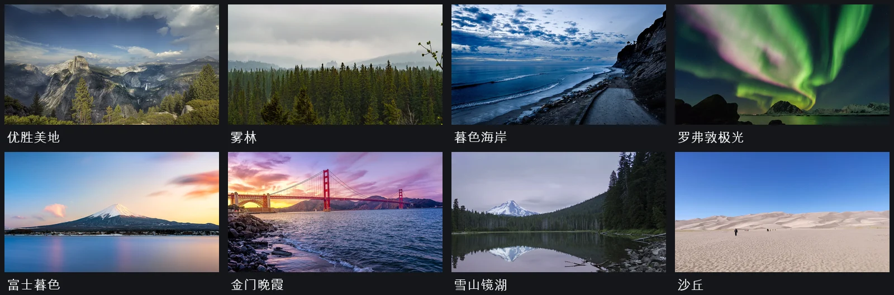

# Wallpapers and video

The current source includes 20 wallpaper choices: eight landscape photographs, two painted landscapes, five original procedural styles, four still frames and one muted video loop from *Spring* (2019). Choose them from the thumbnail gallery in **设置 → 壁纸**. Home and the screen saver use the same selection. All media works offline.

The photograph pack, thumbnail gallery, matching static screen saver and removal of the video's dark title fade are unreleased changes; the published 0.1.11 APK has the original ten options.

## Landscape photographs



The photographs are center-cropped to 16:9 and encoded as WebP. Yosemite and Mount Fuji use 3840 × 2160 originals; the other six remain 1920 × 1080. Two David Revoy paintings also use 3840 × 2160 images, without upscaling. The gallery marks these four images **4K** and uses separate 320 × 180 previews. Static images do not run a video decoder or a continuous animation loop. Source resolution does not change a TV firmware's desktop output resolution.

| Wallpaper | Photographer | License |
| --- | --- | --- |
| [优胜美地](https://commons.wikimedia.org/wiki/File:Yosemite_by_Carol_M._Highsmith.jpg) | Carol M. Highsmith | Public domain |
| [雾林](https://commons.wikimedia.org/wiki/File:Bosque_nublado.jpg) | Lana Neiman | CC0 |
| [暮色海岸](https://commons.wikimedia.org/wiki/File:Coast_on_a_cloudy_evening_(Unsplash).jpg) | Kaiwen Wang ulei | CC0 |
| [罗弗敦极光](https://commons.wikimedia.org/wiki/File:Lofoten,_Norway_(Unsplash).jpg) | Johannes Groll followhansi | CC0 |
| [富士暮色](https://commons.wikimedia.org/wiki/File:Mount_Fuji_at_sunset,_March_2025.jpg) | Romain Guy from San Francisco, USA | CC0 |
| [金门晚霞](https://commons.wikimedia.org/wiki/File:Golden_Gate_Bridge_at_Purple_sunset.jpg) | Umer Sayyam | CC0 |
| [雪山镜湖](https://commons.wikimedia.org/wiki/File:Lake_Mountain_Landscape.jpg) | Bonnie Moreland | CC0 |
| [沙丘](https://commons.wikimedia.org/wiki/File:Colorado_Great_Sand_Dunes_National_Park.jpg) | Mshuang2 | CC0 |

The source pages document each image's rights. The older Unsplash photographs here were released under CC0; this is not a claim that current Unsplash uploads use CC0. Exact download URLs, modifications and SHA-256 hashes are in [wallpaper-sources.json](wallpaper-sources.json), also bundled in the APK.

The two paintings, [Episode 38: The Healer landscape](https://www.peppercarrot.com/en/viewer/wallpapers-src__2023-04-26_Episode-38-The-Healer-landscape_by-David-Revoy.html) and [Landscape study C](https://www.peppercarrot.com/en/viewer/misc-src__2022-02-18_Landscape-study-C-00h45_by-David-Revoy.html), are by David Revoy, CC BY 4.0. They are center-cropped and downsampled from the author's high-resolution exports. Their credits, original dimensions and hashes are in the same provenance file.

Design reference: [Nathan Clark's launcher study](https://x.com/nathanclark/status/2112329341619294527), especially the landscape composition and quiet controls. No image or code from that post is included.

## Adaptive backgrounds

The five procedural styles (流光、潮汐、玫瑰暮色、暖砂、夜紫) vary with local date/time, work without a decoder or network, and use the application code license. Their continuous motion stops when hidden and follows the motion setting. The new photographs remain still; they are not additional videos.

## Included media

© Blender Foundation | cloud.blender.org/spring. Licensed under [CC BY 4.0](https://creativecommons.org/licenses/by/4.0/), as stated on the [Spring rights page](https://studio.blender.org/projects/spring/pages/about/).

The video is an excerpt at 00:24.2–00:29.0, without audio, scaled to 1280 × 536 and re-encoded as H.264 at 30 fps. Forward and reverse playback form a 9.6-second loop. The poster and four JPEG stills were extracted from that edited excerpt. No title sequence or project logos are included.

Exact provenance, modifications and hashes:

- [Video and poster](app/src/main/assets/video-wallpaper-source.json)
- [Four stills](wallpaper-sources.json), also included in the APK
- [Bundled attribution and licenses](app/src/main/assets/OPEN_SOURCE_LICENSES.txt)

The previous privately used illustration pack had no verified redistribution permission. Those images are excluded from the public source snapshot and its main-branch history. Do not include them in release APKs. The application's GPL-3.0 code license does not grant rights to third-party media.

## Personal video

For a video you have permission to use, copy `wallpaper.mp4` and a matching `wallpaper.jpg` into the app-specific `Android/data/com.sogud.bananatv/files/wallpapers/` directory with ADB. There is no in-app importer yet:

```sh
adb -s TV_IP:5555 shell mkdir -p /sdcard/Android/data/com.sogud.bananatv/files/wallpapers
adb -s TV_IP:5555 push YOUR_VIDEO.mp4 /sdcard/Android/data/com.sogud.bananatv/files/wallpapers/wallpaper.mp4
adb -s TV_IP:5555 push YOUR_POSTER.jpg /sdcard/Android/data/com.sogud.bananatv/files/wallpapers/wallpaper.jpg
```

Select **云海山谷**; it becomes **本地动态壁纸** when a local video exists. Relaunch after replacing files. Removing these two files restores the bundled video. File access through ADB depends on the TV firmware.

Home and the screen saver share the video component when a video is selected. Playback is muted; the player is released when the screen is no longer visible. The poster remains if decoding fails. Video frame rate and interaction frame times are separate measurements.
